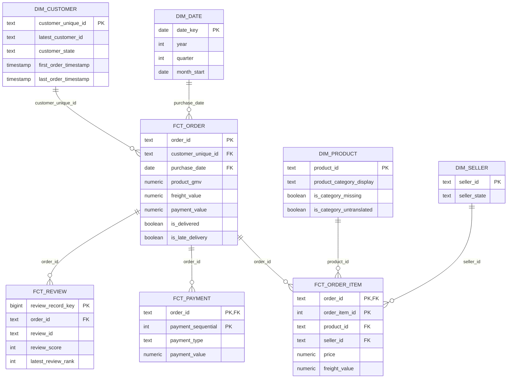

# Core Data Model and Performance Marts

## 1. Stage outcome

Stage 5 builds a reusable star-oriented analytical model from the typed staging views. It creates five dimensions, four facts and four performance marts.

| Layer | Object count | Purpose |
|---|---:|---|
| `core` dimensions | 5 | Conformed dates, customers, products, sellers and ZIP locations |
| `core` facts | 4 | Orders, order items, payments and reviews at explicit grains |
| `mart` | 4 | Monthly business, category, customer-state and seller KPIs |
| Stage 5 assertions | 24 | Grain, coverage, amount reconciliation and mart validation |

## 2. Logical model



`dim_geolocation` is intentionally not connected by a database foreign key. It contains one representative row per ZIP prefix, while some customer or seller ZIP prefixes may not exist in the source geolocation file. Power BI can use it as an optional lookup after relationship coverage is measured.

## 3. Core grains and row counts

| Object | Grain | Rows | Key |
|---|---|---:|---|
| `core.dim_date` | One calendar date in the observed purchase range | 774 | `date_key` |
| `core.dim_customer` | One `customer_unique_id` | 96,096 | `customer_unique_id` |
| `core.dim_product` | One product | 32,951 | `product_id` |
| `core.dim_seller` | One seller | 3,095 | `seller_id` |
| `core.dim_geolocation` | One five-digit ZIP prefix | 19,015 | `geolocation_zip_code_prefix` |
| `core.fct_order` | One order | 99,441 | `order_id` |
| `core.fct_order_item` | One item sequence within an order | 112,650 | (`order_id`, `order_item_id`) |
| `core.fct_payment` | One payment sequence within an order | 103,886 | (`order_id`, `payment_sequential`) |
| `core.fct_review` | One source review record | 99,224 | generated `review_record_key` |

## 4. Modeling decisions

### Customers

`customer_unique_id` is the customer dimension key. When a customer has multiple order-specific records, the dimension retains the location attached to the latest order and separately records first/last order timestamps and source order count.

Order facts retain both `customer_id` and `customer_unique_id`, so order-level source traceability is not lost.

### Products and category translation

The product dimension preserves Portuguese and English category fields and adds `product_category_display`:

1. English translation when available;
2. Portuguese category when translation is missing;
3. `unknown` when the source category itself is missing.

Flags distinguish missing source categories from untranslated categories.

### Geolocation

The raw geolocation file has many coordinates per ZIP prefix. The dimension uses:

- median latitude and longitude per prefix, reducing sensitivity to coordinate outliers;
- the most frequent state/city combination, with deterministic alphabetical tie-breaking;
- the raw coordinate count for auditability.

### Reviews

Reviews do not have a reliable natural row key: both `review_id` and `order_id` repeat. The fact therefore adds `review_record_key` and preserves all 99,224 records.

For order-level reporting, `fct_order` selects one latest review per order using:

1. latest answer timestamp;
2. latest creation timestamp;
3. descending review ID as deterministic tie-breaker.

The full review fact remains available for sensitivity checks.

### Order-level amount aggregation

Items, payments and reviews are aggregated independently before joining to the order fact. This prevents the many-to-many multiplication that would occur if all three child tables were joined directly.

The order fact contains separate measures:

- `product_gmv`: sum of item prices, excluding freight;
- `freight_value`: sum of item freight;
- `gross_order_value`: product GMV plus freight;
- `payment_value`: sum of payment records.

Payment value is retained as a reconciliation measure and is not redefined as GMV.

## 5. Performance marts

| Mart | Grain | Rows | Main use |
|---|---|---:|---|
| `mart.monthly_business_kpis` | One purchase month | 26 | Executive trend and KPI decomposition |
| `mart.monthly_category_kpis` | Month × displayed category | 1,273 | Category drill-down |
| `mart.monthly_customer_state_kpis` | Month × customer state | 556 | Geographic drill-down |
| `mart.monthly_seller_kpis` | Month × seller | 16,068 | Seller contribution analysis |

### Monthly business metrics

The main mart uses delivered orders and calculates:

- GMV, freight, gross order value and payment value;
- order count and purchasing customer count;
- AOV, orders per customer, items per order and average item price;
- previous-month values and month-over-month rates;
- three-month moving-average GMV;
- `is_complete_month` for excluding the partial boundary months.

The observed range contains 26 calendar months, but timestamp boundaries alone do not guarantee comparable coverage. Profiling found a sparse pilot period in 2016 and no delivered orders after August 2018. The explicit comparison window is therefore `2017-01` through `2018-08`, leaving 20 months eligible for standard trend comparisons. MoM rates are null when either adjacent month is outside this window.

### Additivity warning

GMV and item count are additive across categories and sellers because every item has one product and seller. Category and seller `order_count` and `purchasing_customer_count` are not additive: one order or customer can appear in multiple categories or sellers.

State-level order counts are additive because each order is assigned to one customer delivery state.

## 6. Reconciliation results

All comparisons are performed in integer cents.

| Check | Result |
|---|---:|
| All-item GMV: staging → item fact → order fact | 13,591,643.70 |
| Freight: item fact → order fact | 2,251,909.54 |
| Payments: payment fact → order fact | 16,008,872.12 |
| Delivered-order GMV: order fact → monthly mart | 13,221,498.11 |
| Delivered-item GMV: category mart | 13,221,498.11 |
| Delivered-order GMV: customer-state mart | 13,221,498.11 |
| Delivered-item GMV: seller mart | 13,221,498.11 |

The difference between all-item and delivered-order GMV reflects the documented success-order filter, not a join discrepancy.

## 7. Execution

After Stage 4 has completed:

```powershell
.\sql\run_stage_05.ps1
```

The build is intentionally replaceable: it removes existing project-scoped core objects and their dependent marts, recreates them in order, and stops immediately if any SQL assertion fails.
