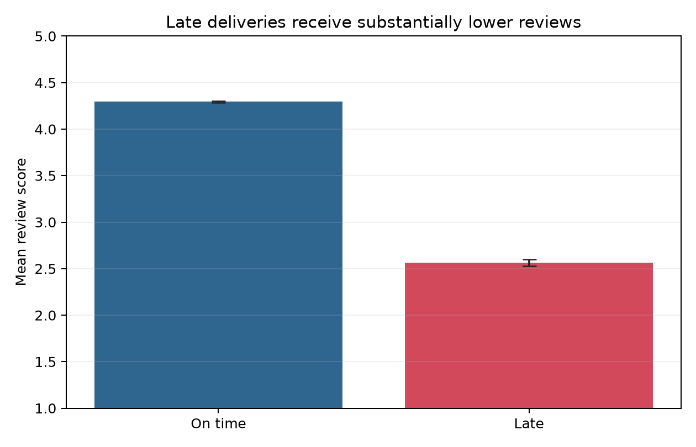
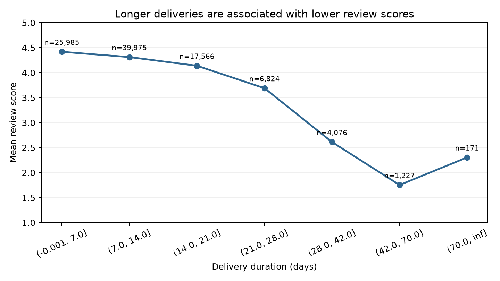

# Delivery and Review Statistical Analysis

## 1. Executive summary

The statistical sample contains **95,824 delivered orders** with a valid actual delivery timestamp, promised delivery timestamp and latest review score. Of these, **7,661 were late**, producing a late-delivery rate of **7.99%** (95% Wilson CI: **7.82%-8.17%**).

Late orders received an average review score of **2.565**, compared with **4.294** for on-time orders. The late-minus-on-time difference was **-1.729 points** (95% CI: **-1.767 to -1.691**; Welch t = -89.41; p < 0.001). The standardized effect was large (Hedges' g = **-1.445**), so the finding is both statistically significant and operationally material.

Low reviews, defined as scores 1-2, occurred on **54.07%** of late orders versus **9.22%** of on-time orders, a descriptive gap of **44.84 percentage points**. Delivery duration and review score also had a negative Spearman association (rho = **-0.235**, approximate 95% CI: **-0.241 to -0.229**; p < 0.001).

These results identify late delivery as a high-priority experience signal. They do not establish that lateness itself caused each low review because assignment to late delivery was not randomized and unobserved product, seller or customer factors may affect both outcomes.

## 2. Question and hypotheses

The primary business question is:

> Do late delivered orders receive meaningfully lower review scores than on-time delivered orders?

The primary statistical contrast is late minus on-time mean review score.

- Null hypothesis: the two population means are equal.
- Alternative hypothesis: the two population means differ.
- Significance threshold: alpha = 0.05, two-sided.
- Business interpretation: report the point difference, 95% confidence interval and standardized effect rather than relying on the p-value alone.

The two-sided test avoids defining the result in advance, although the business expectation is directional. No multiple-comparison adjustment is applied because one primary contrast is declared; the other analyses are supporting diagnostics and robustness checks.

## 3. Analysis sample and exclusions

The SQL mart uses one row per order and includes only orders that are:

1. marked `delivered`;
2. associated with both actual and estimated customer-delivery timestamps;
3. associated with a latest review score.

| Sample step | Orders |
|---|---:|
| Delivered orders | 96,478 |
| With actual and estimated delivery timestamps | 96,470 |
| With delivery timestamps and latest review | 95,824 |
| Excluded because the latest review is missing | 646 |

The 95,824 orders represent 92,747 unique customers. The main analysis retains every eligible order because the business unit is the order experience. A sensitivity analysis keeps only each customer's earliest eligible order to assess the small amount of repeated-customer dependence.

No valid non-negative delivery durations are trimmed. The longest delivery durations remain in the sample, while the rank-based correlation and non-parametric comparison reduce dependence on their exact magnitude.

## 4. Descriptive statistics

| Metric | On time | Late |
|---|---:|---:|
| Orders | 88,163 | 7,661 |
| Mean review score | 4.294 | 2.565 |
| Review-score standard deviation | 1.147 | 1.658 |
| 95% CI for mean review | 4.287-4.302 | 2.528-2.602 |
| Median review score | 5 | 2 |
| Review-score IQR | 4-5 | 1-4 |
| Low-review rate (score 1-2) | 9.22% | 54.07% |
| Mean delivery duration | 10.88 days | 31.38 days |
| Median delivery duration | 9.72 days | 29.08 days |
| 90th percentile delivery duration | 19.26 days | 47.76 days |



The large difference is visible in the full score distribution, not only in the mean: the median shifts from 5 to 2 and the interquartile ranges have limited overlap.

## 5. Inferential results

### 5.1 Welch mean comparison

Welch's independent-samples t test is the primary mean comparison because review-score variance differs substantially between late and on-time orders and the group sizes are unequal.

| Statistic | Result |
|---|---:|
| Late minus on-time mean difference | -1.729 |
| 95% confidence interval | [-1.767, -1.691] |
| Welch t statistic | -89.412 |
| Welch degrees of freedom | 8,309.03 |
| p-value | < 0.001 |
| Hedges' g | -1.445 |

Review score is bounded and ordinal, so normality at the observation level is not plausible. With large independent groups, the sampling distribution of the mean difference is nevertheless stable. Welch's method avoids the equal-variance assumption, and the non-parametric result below checks that the conclusion is not an artifact of comparing means.

### 5.2 Distributional robustness

The Mann-Whitney test also rejects equal score distributions (p < 0.001). Its rank-biserial effect is **-0.554**, indicating that late orders tend to have substantially lower scores across the ranked distribution.

P-values are stored as `0.0` in the generated JSON because they underflow standard floating-point precision; this means extremely small, not literally zero. The portfolio report therefore uses the threshold `p < 0.001`.

### 5.3 Correlation with delivery duration

Spearman rank correlation is the primary correlation measure because review score is ordinal and delivery duration is right-skewed.

| Measure | Estimate | 95% CI | p-value |
|---|---:|---:|---:|
| Spearman rho | -0.235 | [-0.241, -0.229] | < 0.001 |
| Pearson r, sensitivity | -0.334 | Not primary | < 0.001 |

The Spearman result is a modest negative monotonic association. It is smaller than the late/on-time standardized mean effect because late status compares performance with the promised date, while raw duration alone does not account for different delivery promises.



The duration-band chart is descriptive rather than a fitted dose-response curve. The 70-day-plus tail contains only 171 orders and should not be used to claim that the association is strictly monotonic at every extreme.

## 6. Robustness and assumption checks

### Customer-level independence

Keeping only the earliest eligible order for each of 92,747 customers produces a mean difference of **-1.734** (95% CI: **-1.773 to -1.696**) and Hedges' g of **-1.449**. This is nearly identical to the order-level estimate, so the small repeat-customer share does not explain the result.

### Time and geography composition

For each stratum, the analysis compared late and on-time mean review scores only when both groups contained at least 30 orders:

- all **19 of 19 eligible purchase months** had a lower late-order mean, with differences ranging from -2.057 to -0.844 points;
- all **22 of 22 eligible customer states** had a lower late-order mean, with differences ranging from -2.361 to -1.094 points.

This consistency shows that the overall difference is not limited to one large month or state. It is not equivalent to full causal adjustment and does not remove seller, category, promise-setting or unobserved-customer confounding.

## 7. Business interpretation and action

The result passes three decision tests:

1. **Precision:** the confidence interval is narrow because the sample is large.
2. **Magnitude:** a 1.73-point difference on a five-point scale and a 44.84-point low-review-rate gap are operationally large.
3. **Consistency:** the direction persists in non-parametric, customer-level, monthly and state-level checks.

Recommended actions:

- prioritize better estimated-delivery accuracy and proactive management of orders predicted to miss the promise;
- monitor both late-delivery rate and low-review rate, segmented by state, seller and category;
- do not interpret notification or compensation as proven remedies from this dataset;
- use the next project stage to design a randomized experiment for proactive late-delivery communication, with review or low-review rate as an outcome and cancellation/cost guardrails.

## 8. Reproducibility and quality controls

Run from the repository root after Stage 7:

```powershell
powershell -NoProfile -ExecutionPolicy Bypass -File .\sql\run_stage_08.ps1
```

The runner:

1. rebuilds `mart.delivery_review_orders`;
2. executes six fail-fast SQL assertions;
3. exports the order-grain CSV to the ignored `data/exports` directory;
4. runs the Python analysis and regenerates the JSON, CSV and figures;
5. runs five unit tests for the reusable statistical functions.

Machine-readable results are stored in `python/outputs/stage08_results.json`. Across Stages 4-8, the SQL suite now contains **86 assertions**.

## 9. Limitations

- The data is observational; association is not causation.
- Missing reviews may be selective rather than random.
- Review score is an ordinal five-point outcome; means are useful summaries but do not capture every distributional feature.
- Estimated delivery dates may themselves reflect destination, seller and item complexity.
- Product category, seller performance and customer expectations can confound the association.
- The Fisher-z interval for Spearman rho is a large-sample approximation.
- The historical dataset cannot show whether any proposed operational intervention would be cost-effective.

