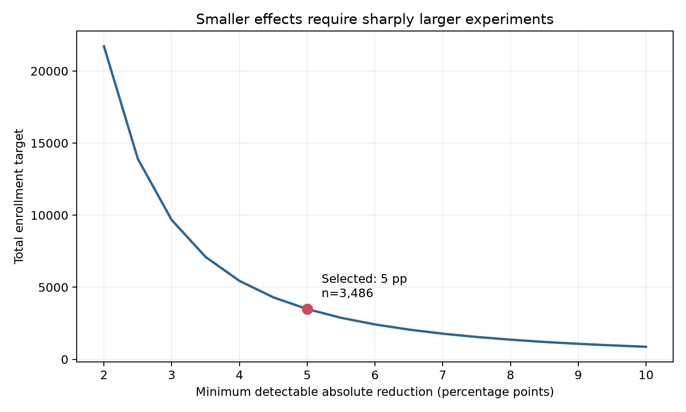

# A/B Test Design: Proactive Delay Communication

## 1. Decision summary

Stage 8 found that late delivered orders had a **54.07% low-review rate** (scores 1-2), compared with 9.22% for on-time orders. This is a strong prioritization signal, but the historical data cannot show whether communication can improve the customer response to a delay.

The proposed experiment tests a single intervention:

> When an in-flight order is predicted to miss its promised delivery date, send a proactive message at least 24 hours before that date with a clear delay notice, updated ETA and support link.

The control group receives the existing communication flow. The treatment deliberately excludes a voucher so the first experiment isolates the communication effect and avoids combining two mechanisms. Compensation can be tested later for customers with more severe delays or in a factorial follow-up.

The primary metric is the low-review rate among reviewed first eligible orders. With a planning baseline of 54.07%, an absolute MDE of 5 percentage points, two-sided alpha of 0.05 and 80% power, the design requires **1,568 analyzable customers per arm**. Allowing 10% for missing or non-analyzable outcomes increases enrollment to **1,743 per arm, 3,486 total**.

## 2. Hypothesis and experimental population

### Business hypothesis

Setting expectations before a promised date is missed will reduce severe dissatisfaction even when the physical delivery path cannot be changed.

### Statistical hypothesis

Let `p_treatment` and `p_control` be the proportions of submitted reviews scoring 1-2.

- H0: `p_treatment = p_control`
- H1: `p_treatment != p_control`
- Expected direction: `p_treatment < p_control`
- Primary test: two-sided, alpha = 0.05

A two-sided test protects against an intervention that unexpectedly increases dissatisfaction. The expected direction does not change the significance threshold.

### Eligibility

An order becomes eligible when all conditions are met:

- an operational model flags a material risk of missing the promised date;
- the flag occurs at least 24 hours before the promised date;
- the order has not already been delivered or cancelled;
- the customer has a valid communication channel and has not opted out;
- the customer has not previously entered this experiment.

The last rule creates one primary observation per customer and prevents the same customer from experiencing both variants.

The historical dataset identifies orders that were actually late only after delivery. Production eligibility must instead use information available before the intervention. A two-week shadow run is required to estimate the risk model's flagged volume, precision, baseline low-review rate and review completion rate before launch.

## 3. Randomization and implementation

| Design element | Specification |
|---|---|
| Randomization unit | `customer_unique_id` |
| Allocation | 50% control, 50% treatment |
| Assignment | Stable server-side hash with experiment ID and customer ID |
| Blocking variables | Risk-score band, customer state and eligibility week |
| Primary observation | First eligible order after assignment |
| Analysis principle | Intention to treat according to assigned variant |

Customer-level assignment prevents contamination when one customer has multiple eligible orders. Blocking improves balance in variables strongly related to lateness without changing random assignment. Assignment must be logged before message delivery, including eligibility timestamp, variant, model score, promised date and message-delivery status.

The control path must remain operationally identical to business as usual. The treatment message template, send timing and updated-ETA calculation must be frozen before launch.

## 4. Metrics

### Primary metric

**Low-review rate:** reviewed first eligible orders with a latest score of 1-2 divided by reviewed first eligible orders.

The metric is binary, directly connected to the Stage 8 problem and easier to translate into prevented negative experiences than a small change in average score.

### Secondary metrics

- mean and distribution of review score;
- review completion rate;
- customer-support contact rate within 14 days;
- cancellation or refund-request rate;
- message delivery and click-through rates;
- 90-day repeat-purchase rate as a long-horizon exploratory outcome.

### Guardrails

- review completion-rate difference no worse than -1 percentage point;
- cancellation/refund-request rate does not increase materially;
- opt-out and complaint rates remain within the pre-approved safety threshold;
- message delivery failures and duplicate sends remain below operational thresholds;
- no meaningful degradation in actual delivery time, which the message should not affect.

The primary metric is conditional on submitting a review. If treatment changes review completion by more than 1 percentage point, the low-review comparison is considered potentially selected and cannot support rollout on its own. Pre-specified missing-outcome bounds and a follow-up survey should then be reported.

## 5. Sample-size assumptions

| Parameter | Value |
|---|---:|
| Historical planning baseline | 54.07% low reviews |
| Selected treatment target | 49.07% |
| Absolute MDE | 5 percentage points |
| Relative reduction | 9.25% |
| Cohen's h | 0.100 |
| Significance level | 0.05, two-sided |
| Power | 80% |
| Allocation | 1:1 |
| Required analyzable sample | 1,568 per arm |
| Assumed analyzable fraction | 90% |
| Enrollment target | 1,743 per arm; 3,486 total |

The 5-point MDE is a business threshold as well as a statistical input: at that effect, every 1,000 reviewed treatment orders would produce approximately **50 fewer low reviews**. A smaller effect may still be real, but it needs a much longer test and may not justify operational complexity.

| Absolute MDE | Relative reduction | Sample/arm | Total analyzable | Total enrollment target |
|---:|---:|---:|---:|---:|
| 3 pp | 5.55% | 4,348 | 8,696 | 9,664 |
| **5 pp** | **9.25%** | **1,568** | **3,136** | **3,486** |
| 8 pp | 14.80% | 613 | 1,226 | 1,364 |
| 10 pp | 18.50% | 392 | 784 | 872 |



The calculation uses the normal approximation for two independent proportions. The historical baseline is a planning proxy based on orders known to be late after the event. The shadow-run baseline from the actual pre-delivery eligibility rule must replace it before final launch approval.

## 6. Duration and feasibility

From January through August 2018, reviewed orders later known to be late averaged **606.6 per month**, ranging from **83 to 1,463**. This is a conservative capacity proxy, not the expected flagged population.

| Enrollment scenario | Approximate duration |
|---|---:|
| Historical actual-late proxy: 606.6/month | 6 months |
| 500 eligible orders/month | 7 months |
| 1,000 eligible orders/month | 4 months |
| 1,500 eligible orders/month | 3 months |

The experiment should use a sample-size stopping rule and run for at least four complete weeks. It should not stop merely because a planned date arrives. If the shadow run shows that reaching 3,486 customers would take longer than the business can support, the correct choices are to broaden a valid eligibility threshold, accept a larger MDE, or redesign the intervention—not to lower power after seeing results.

## 7. Analysis plan

Before unblinding treatment effects:

1. validate event logging with an A/A or limited ramp;
2. test for sample-ratio mismatch against the planned 50/50 split;
3. verify baseline balance for risk score, state, promised date and order value;
4. lock eligibility, exclusions, metric SQL and analysis code.

The primary analysis reports:

- treatment-control difference in low-review rate;
- relative risk and relative reduction;
- a 95% confidence interval for the absolute difference;
- a two-sided two-proportion test at alpha 0.05;
- raw numerator and denominator for each arm.

A logistic regression including the pre-randomization blocking variables can be reported as a precision sensitivity check. The unadjusted randomized comparison remains primary. Secondary metrics are labeled exploratory; if formal claims are made across several, Holm adjustment will control family-wise error.

No routine efficacy peeking is allowed. Early stopping is permitted only for pre-specified safety harm, severe technical failure or sample-ratio mismatch. A group-sequential design would require adjusted boundaries and is not introduced after launch.

## 8. Decision framework

Statistical significance is necessary but not sufficient.

### Roll out

- treatment significantly reduces low-review rate;
- the estimated reduction meets or exceeds 5 percentage points;
- review-completion and safety guardrails pass;
- message and support costs are below the estimated value of prevented low reviews.

### Target or iterate

- the result is favorable and statistically credible but smaller than 5 points;
- benefits are concentrated in a pre-specified risk band;
- no guardrail is harmed.

In this case, refine the message or restrict rollout to customers with the best benefit-to-cost profile, then validate again.

### Do not roll out

- the confidence interval includes meaningful harm;
- there is no credible improvement at the achieved precision;
- review completion changes enough to invalidate the conditional primary metric;
- cancellation, complaints or operational failures exceed guardrails.

At a 5-point reduction, the number needed to treat is approximately **20 reviewed eligible orders per prevented low review**. The business break-even calculation is therefore:

```text
value per prevented low review
> 20 x incremental communication and service cost per treated order
```

Because the dataset contains no monetary value for reviews or support contacts, the project presents this threshold rather than inventing an ROI.

## 9. Risks and limitations

- The historical baseline uses actual late orders, while live eligibility uses predicted risk.
- The risk model may change population composition during the experiment.
- Review submission is a post-treatment behavior and can create selection bias.
- Customers may receive carrier or seller messages outside the experiment.
- A notification may improve expectations without improving physical delivery.
- Novelty, seasonal demand and carrier disruptions can limit generalization.
- The experiment estimates the combined effect of message content, timing and ETA quality; those components are not separately identified.

## 10. Reproducibility

Run after Stage 8:

```powershell
powershell -NoProfile -ExecutionPolicy Bypass -File .\python\run_stage_09.ps1
```

The runner exports recent planning capacity, regenerates the sample-size scenarios and chart, writes the machine-readable design, and executes all Python unit tests. It does not fabricate treatment outcomes.

