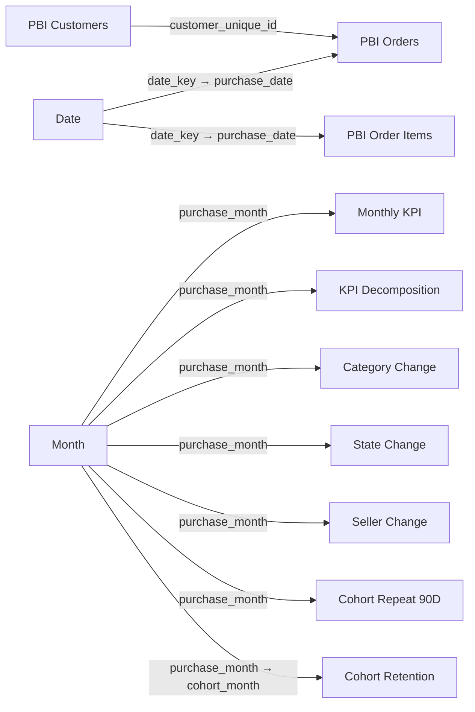

# Power BI model and page specification

## Connection mode

Use PostgreSQL **Import** mode for the portfolio report. The dataset is small enough for responsive interaction, and Import avoids presenting database latency as report latency. The local connection is:

- server: `localhost:5432`;
- database: `olist_ecommerce`;
- authentication: Database username/password from the ignored `.env` file.

Do not store the password in committed Power Query text. If the PostgreSQL connector cannot be used, import the generated CSV files under `data/exports/powerbi`.

## Tables to import

Rename imported tables as shown:

| PostgreSQL object | Power BI name | Purpose |
|---|---|---|
| `core.dim_date` | `Date` | Daily slicers for order-level pages |
| `mart.pbi_months` | `Month` | Month slicers for aggregate marts |
| `mart.pbi_orders` | `PBI Orders` | Executive, delivery and review measures |
| `mart.pbi_order_items` | `PBI Order Items` | Category and seller analysis |
| `mart.pbi_customers` | `PBI Customers` | Repeat purchase and RFM |
| `mart.monthly_business_kpis` | `Monthly KPI` | Validated monthly trend fields |
| `mart.monthly_kpi_decomposition` | `KPI Decomposition` | Exact factor contributions |
| `mart.monthly_category_gmv_change` | `Category Change` | Category contribution ranking |
| `mart.monthly_state_gmv_change` | `State Change` | State contribution ranking |
| `mart.monthly_seller_gmv_change` | `Seller Change` | Seller contribution ranking |
| `mart.cohort_retention` | `Cohort Retention` | Retention matrix |
| `mart.cohort_repeat_90d` | `Cohort Repeat 90D` | Fixed-window cohort comparison |

## Relationships

Use single-direction, one-to-many relationships from the lookup side. Do not enable automatic bidirectional filtering.

Keep `PBI Orders` and `PBI Order Items` as separate fact tables. Do not join them inside Power BI: doing so would create two date-filter paths and invite order-value duplication. Executive and delivery measures use orders; category and seller measures use items.

Mark `Date` as the date table using `date_key`. Sort `Date[year_month]` by `Date[month_start]`, and sort `Month[year_month]` by `Month[purchase_month]`.

## Page 1: Executive Overview

Top row:

- GMV;
- delivered orders;
- AOV;
- purchasing customers;
- all-time repeat rate.

Main visuals:

- monthly GMV with three-month moving average;
- orders and AOV combo chart;
- GMV by customer state;
- top categories by item GMV;
- dynamic `Data Through` and selected-period text.

Use date and customer-state slicers. The headline cards come from `PBI Orders`; the validated trend line can use `Monthly KPI` with its month slicer.

## Page 2: Performance Diagnosis

- waterfall chart for order-volume, basket-size and item-price GMV contributions;
- category contribution bar chart with positive/negative conditional colors;
- state contribution map or ranked bar chart;
- seller contribution table with search and Top N control;
- drill-through page for a selected category or state showing monthly GMV and order trends.

Default the page to a single comparison month because contribution measures describe one month versus its predecessor.

## Page 3: Customer Analytics

- cards for delivered customers, all-time repeat rate, 90-day repeat rate and median days to second order;
- cohort matrix: rows `cohort_month`, columns `month_number`, values maximum `retention_rate`, with heatmap conditional formatting;
- 90-day repeat-rate trend by cohort;
- RFM segment customer count and lifetime GMV;
- segment detail table with recency, frequency and monetary values.

Label the all-time repeat metric as right-censored and the cohort matrix as return activity, not subscription survival.

## Page 4: Delivery & Reviews

- cards for late rate, average delivery days, average review score and low-review rate;
- review-score distribution split by late status;
- delivery-days versus average review-score bands;
- state-level late rate and review score;
- tooltip showing order count and 90th-percentile delivery context where available;
- annotation summarizing the Stage 8 confidence interval and effect size.

The statistical annotation is fixed historical evidence, not a DAX causal estimate: late minus on-time score = -1.729, 95% CI [-1.767, -1.691], Hedges' g = -1.445.

## Interaction rules

- synchronize date slicers only between pages that use the same date table;
- use Edit interactions to prevent a Top N visual from unexpectedly filtering headline cards;
- use report-page tooltips for category, state and RFM definitions;
- add a Reset filters bookmark on every page;
- show units in titles and keep percentage precision consistent;
- retain blank values as blank rather than displaying them as zero.

## Required screenshots

After the report is built, save one full-page PNG per report page under `powerbi/screenshots`:

1. `01_executive_overview.png`
2. `02_performance_diagnosis.png`
3. `03_customer_analytics.png`
4. `04_delivery_reviews.png`

Save the report as a PBIP project when available so model and report definitions are source-control friendly. A PBIX copy can also be retained for recruiter convenience.

